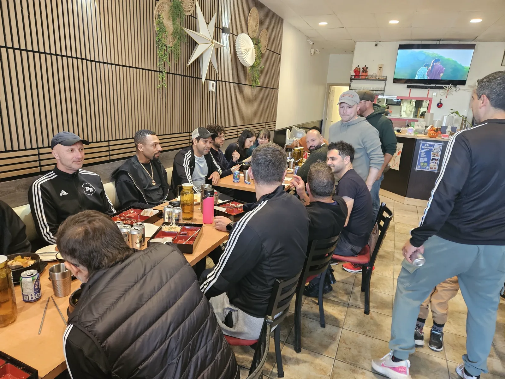
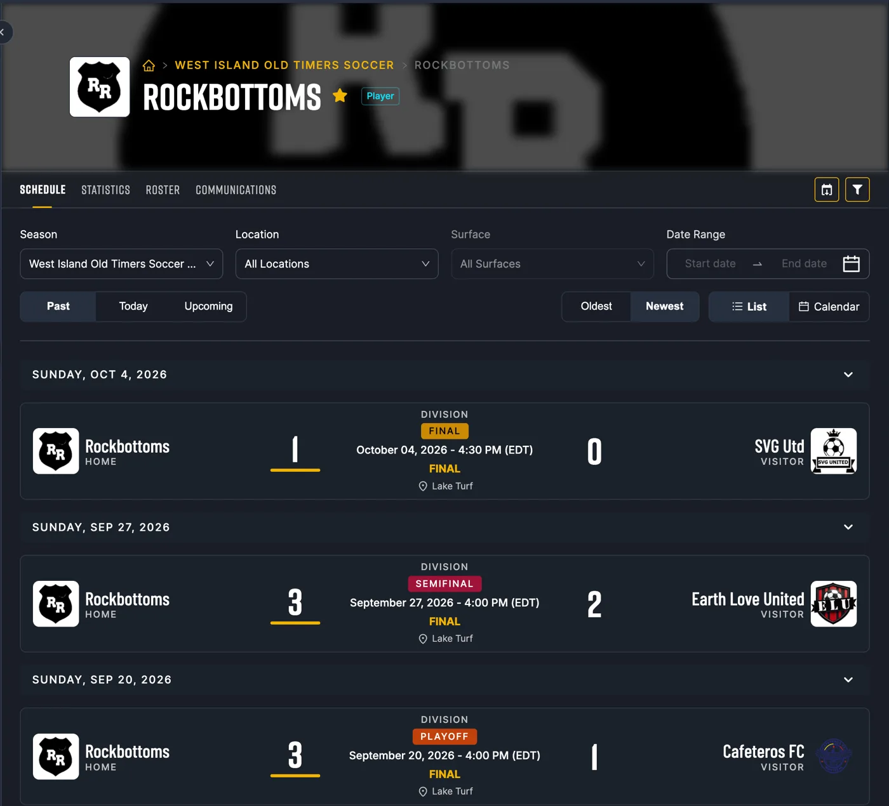
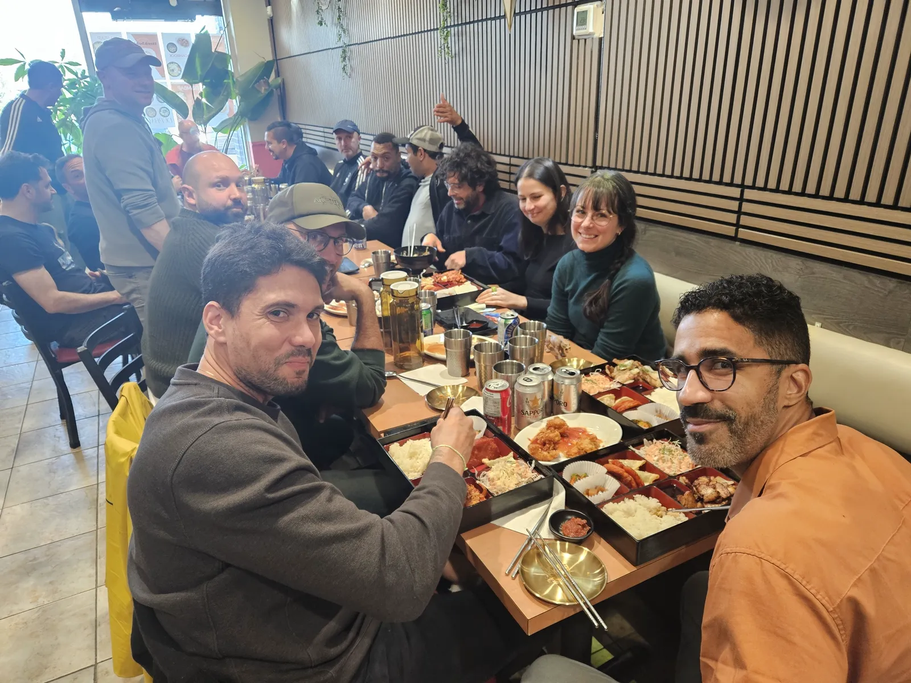
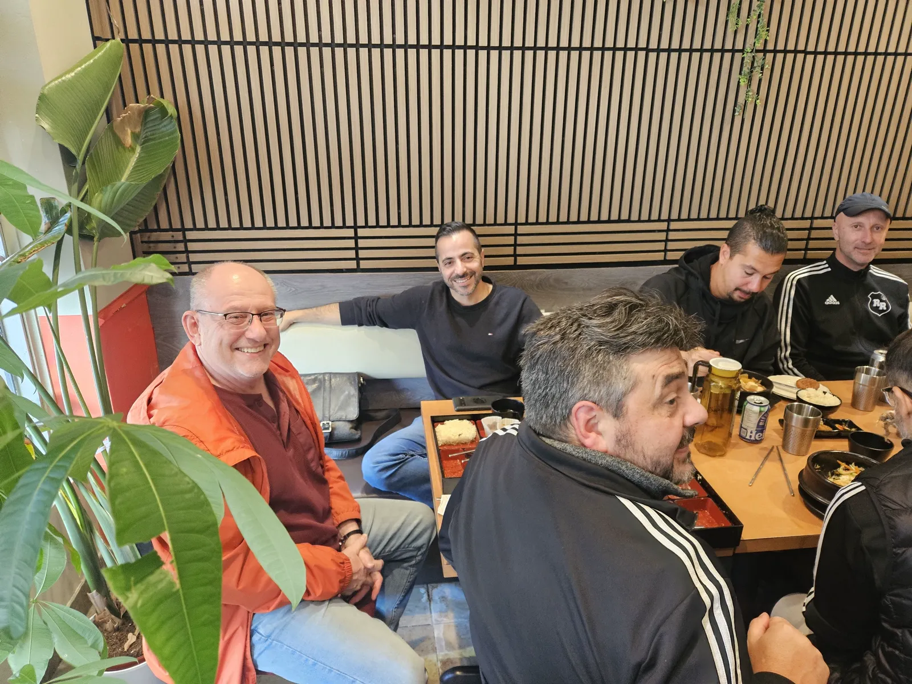
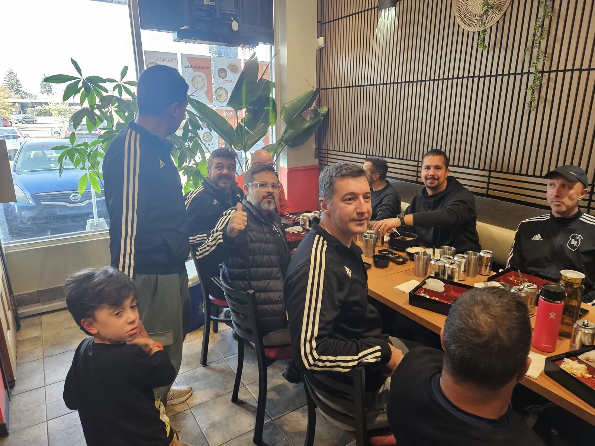
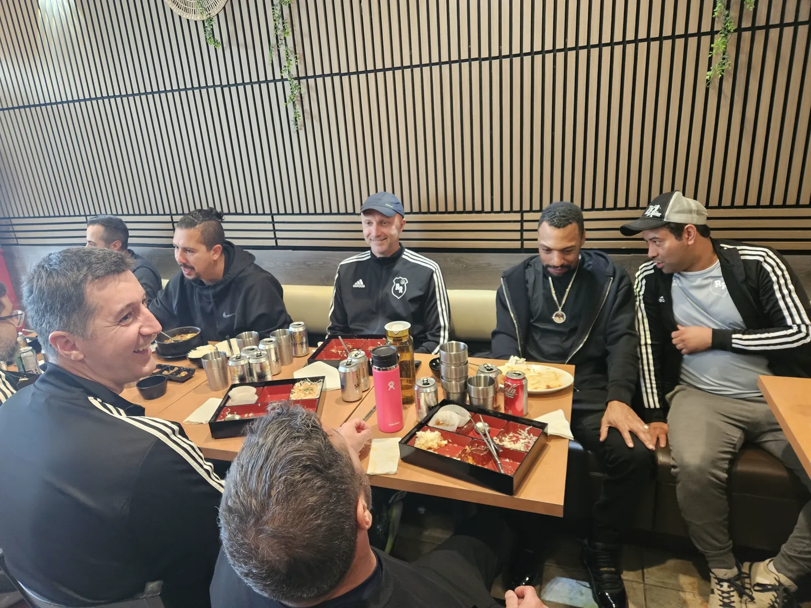
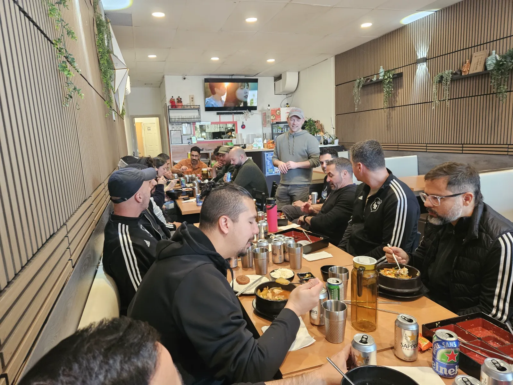

Certains noms d'équipe sont une blague. Le nôtre s'est révélé être une prophétie - mais pas celle que tout le monde attendait.

## Un nom à double sens

Les Rock Bottoms ont été fondés à Pierrefonds, ici même dans notre quartier. Pierre, rock : Pierrefonds Rock Bottom, le nom allait de soi. Mais comme l'a avoué un coéquipier dans son discours aujourd'hui, ce nom a longtemps eu un second sens : nous étions souvent au fond du classement.

Pas cette année. Cette année, les Rock Bottoms sont les champions de la ligue **West Island Old Timers**.

## La route vers le titre

Trois dimanches, trois victoires, toutes au Lake Turf :

- **Éliminatoire**, 20 septembre : Rock Bottoms 3 - 1 Cafeteros FC
- **Demi-finale**, 27 septembre : Rock Bottoms 3 - 2 Earth Love United
- **Finale**, 4 octobre : Rock Bottoms 1 - 0 SVG Utd

La finale s'est jouée à un seul but.

## Une année merveilleuse

<video width="100%" controls playsinline style="border-radius: 10px; margin: 20px 0;">
  <source src="/img/blog/20261101_rockbottom_speech.mp4" type="video/mp4">
</video>

Avec des joueurs comme Chris, l'équipe est devenue très forte, il y a eu des matchs difficiles en chemin, et au bout du compte, ce fut, selon ses mots, *« une année merveilleuse »*. Félicitations à tout le monde!

## Des trophées? Nous avons des roches

Certains joueurs ont reçu un prix. Mais les Rock Bottoms ne remettent pas de trophées ordinaires. Chaque gagnant a reçu une boîte, et dedans - une roche. Que pourrait offrir d'autre une équipe qui porte le nom d'une roche?

## Des boîtes-repas pour les champions

Nous étions fiers d'accueillir la fête chez Doshrock. De longues tables, des boîtes-repas bien remplies, beaucoup de rires, et même notre plus jeune partisan nous a fait un pouce en l'air.

Félicitations, Rock Bottoms. Du fond du classement au sommet de la ligue - et notre table vous est toujours ouverte.

⚽ Allez les Rock Bottoms! 🏆
