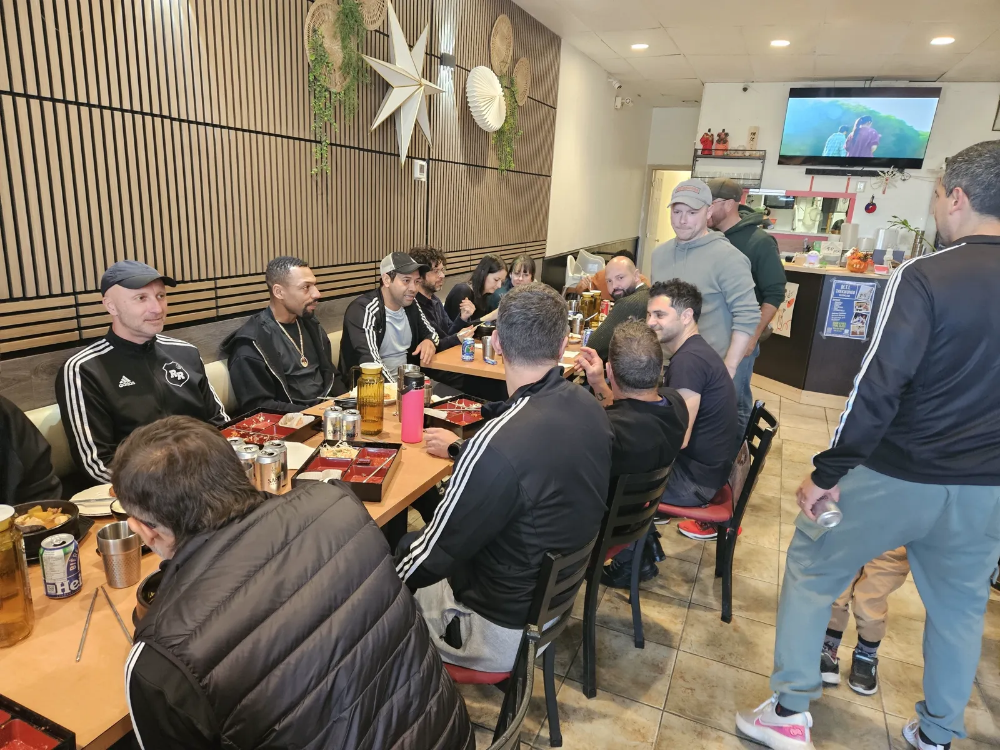
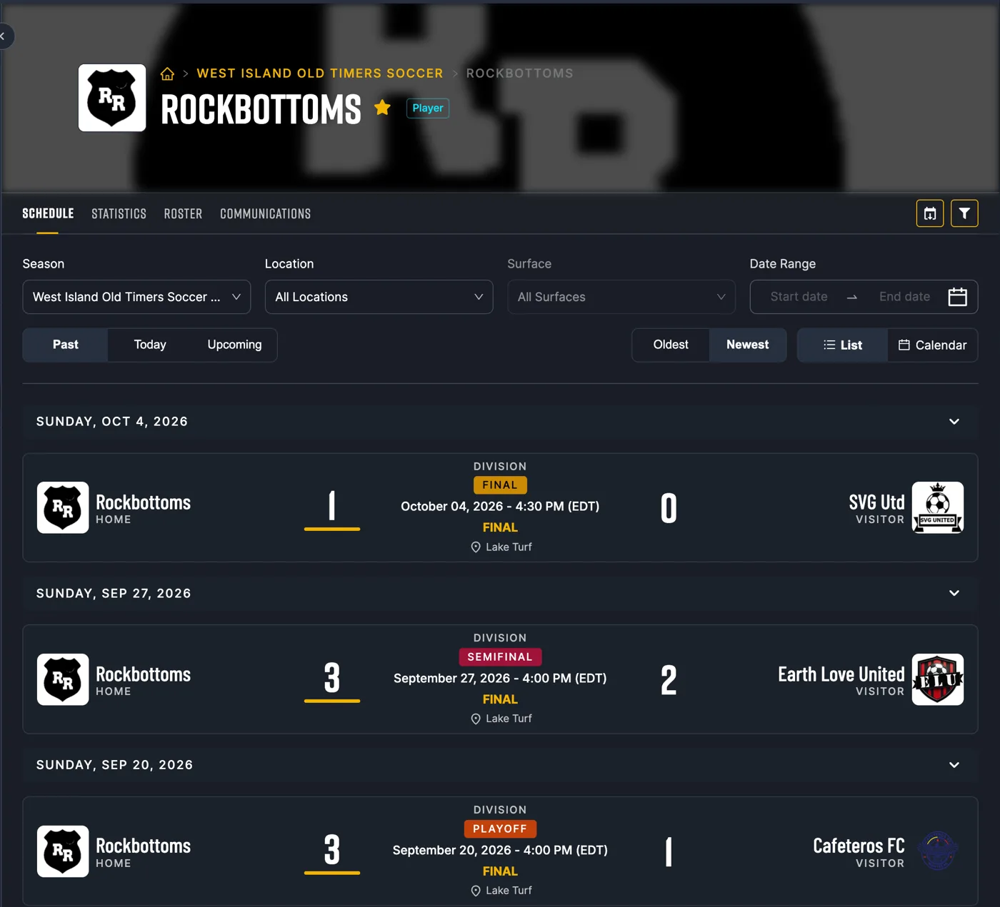
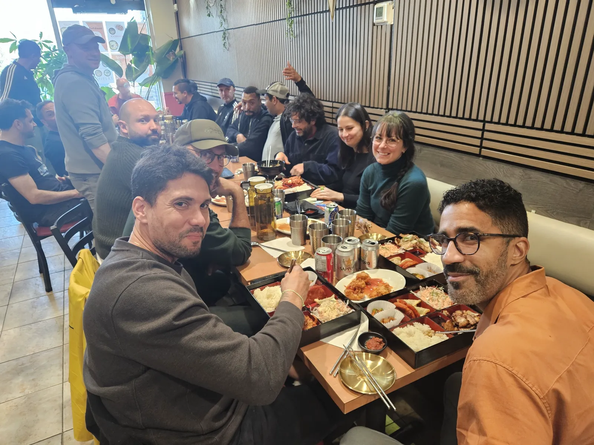
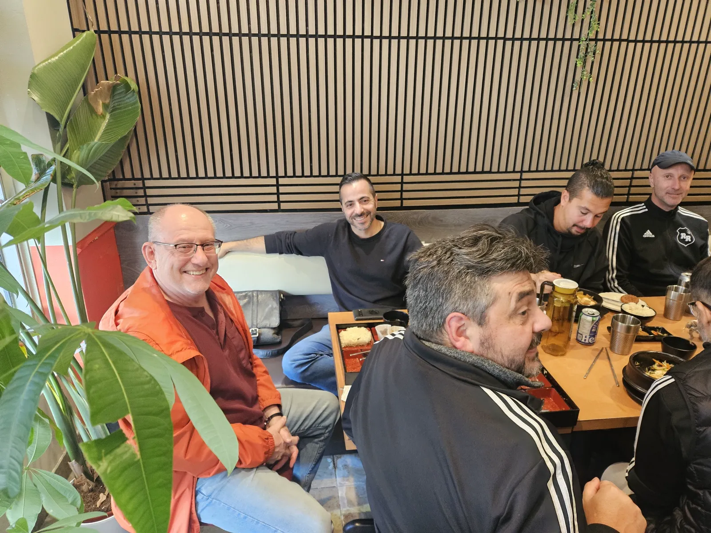
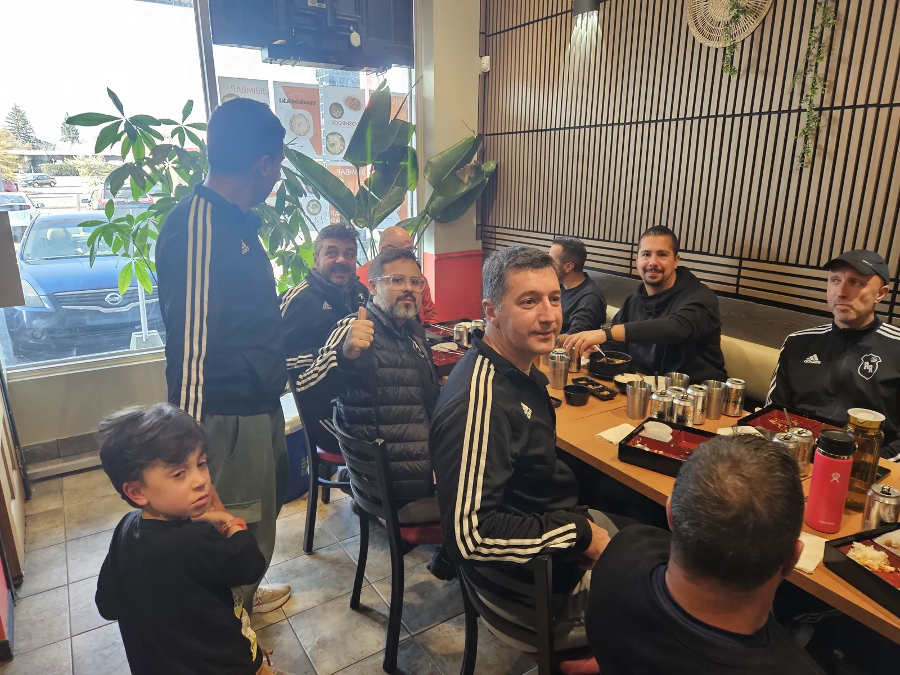
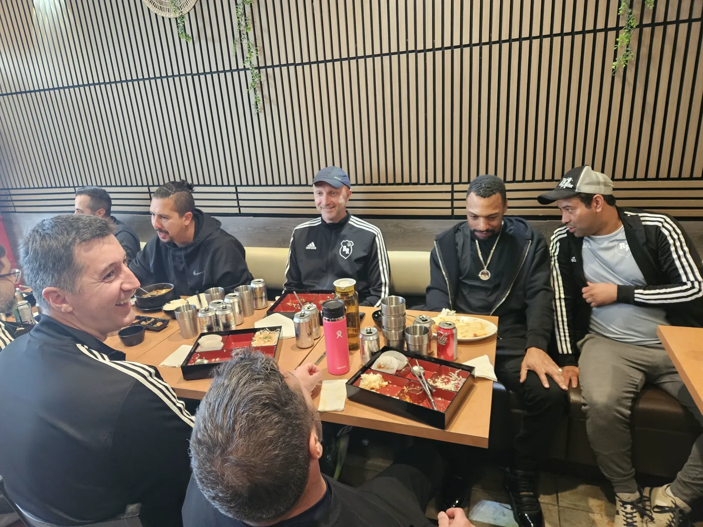
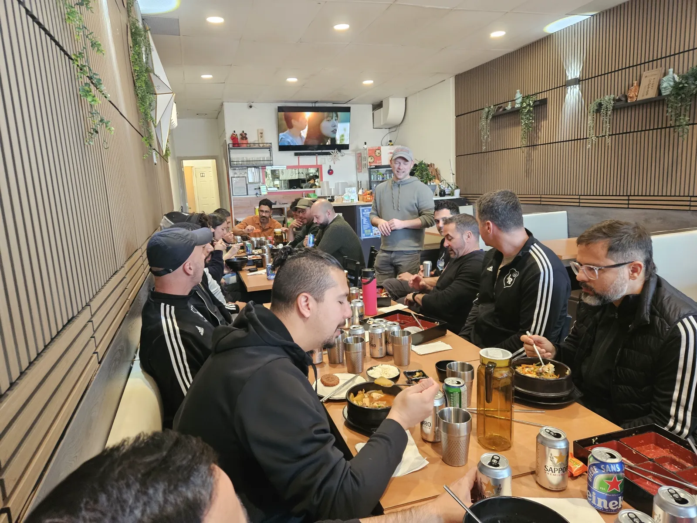

Some team names are a joke. Ours turned out to be a prophecy - just not the one everyone expected.

## A Name With Two Meanings

The Rock Bottoms were founded in Pierrefonds, right here in our neighbourhood. "Pierre" means rock in French, so Pierrefonds Rock Bottom was a natural fit. But as one of our teammates admitted in his speech today, the name had a second meaning for a long time: we were usually at the rock bottom of the standings.

Not this year. This year, the Rock Bottoms are the champions of the **West Island Old Timers** league.

## The Road to the Title

Three Sundays, three wins, all at Lake Turf:

- **Playoff**, September 20: Rock Bottoms 3 - 1 Cafeteros FC
- **Semifinal**, September 27: Rock Bottoms 3 - 2 Earth Love United
- **Final**, October 4: Rock Bottoms 1 - 0 SVG Utd

The final was won by a single goal.

## A Wonderful Year

<video width="100%" controls playsinline style="border-radius: 10px; margin: 20px 0;">
  <source src="/img/blog/20261101_rockbottom_speech.mp4" type="video/mp4">
</video>

The speech was in French, as it should be in a West Island locker room. With players like Chris the team got much stronger, there were some hard games along the way, and in the end it was, in his words, *"une année merveilleuse"* - a wonderful year. Félicitations à tout le monde!

## Trophies? We Have Rocks

There were awards for some of the players. But the Rock Bottoms do not hand out ordinary trophies. Each winner received a box, and inside it - a rock. What else would a team named after rocks give?

## Lunch Boxes for Champions

We were proud to host the celebration at Doshrock. Long tables, full lunch boxes, a lot of laughter, and even our youngest fan gave us a thumbs up.

Congratulations, Rock Bottoms. From the bottom of the standings to the top of the league - and you are always welcome back at our table.

⚽ Go Rock Bottoms! 🏆
