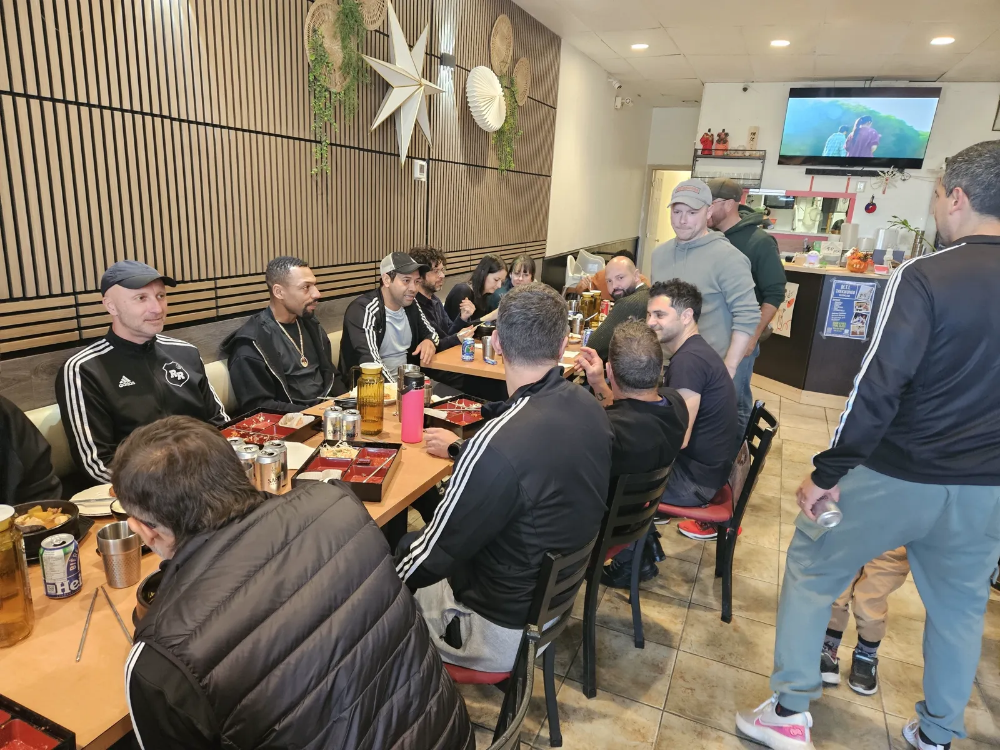
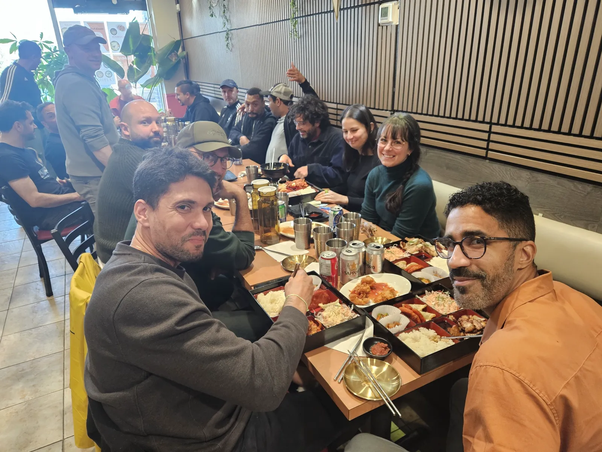
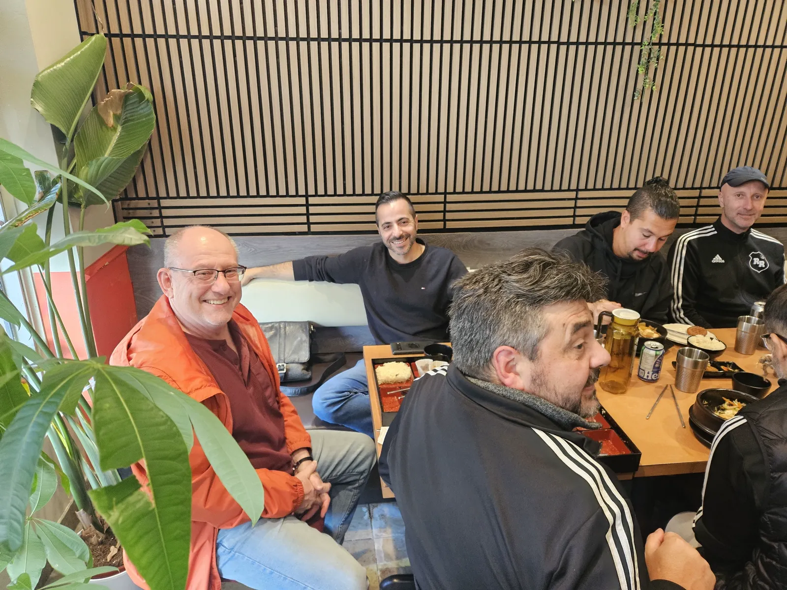
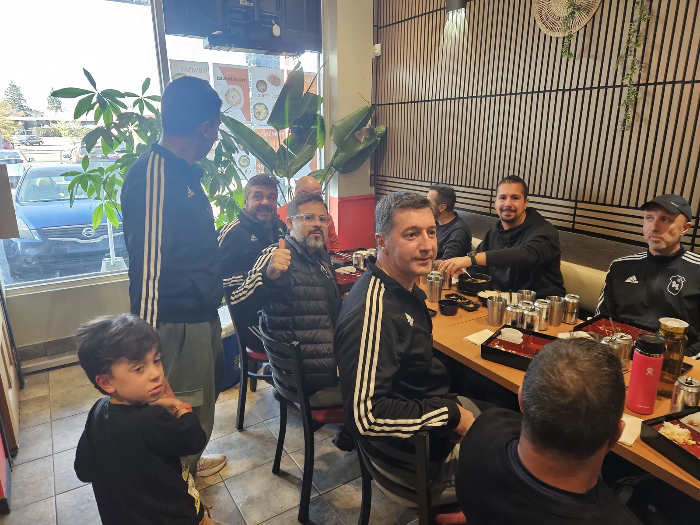
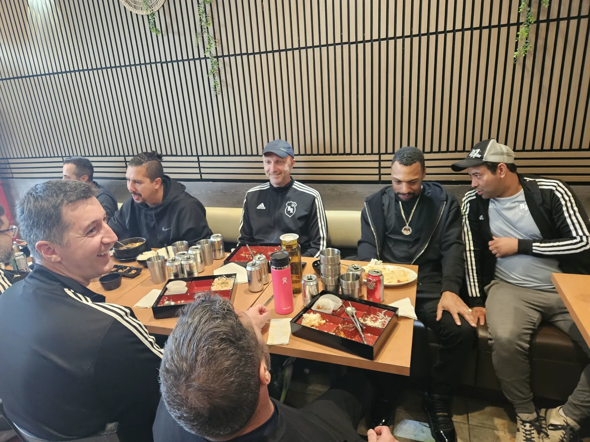
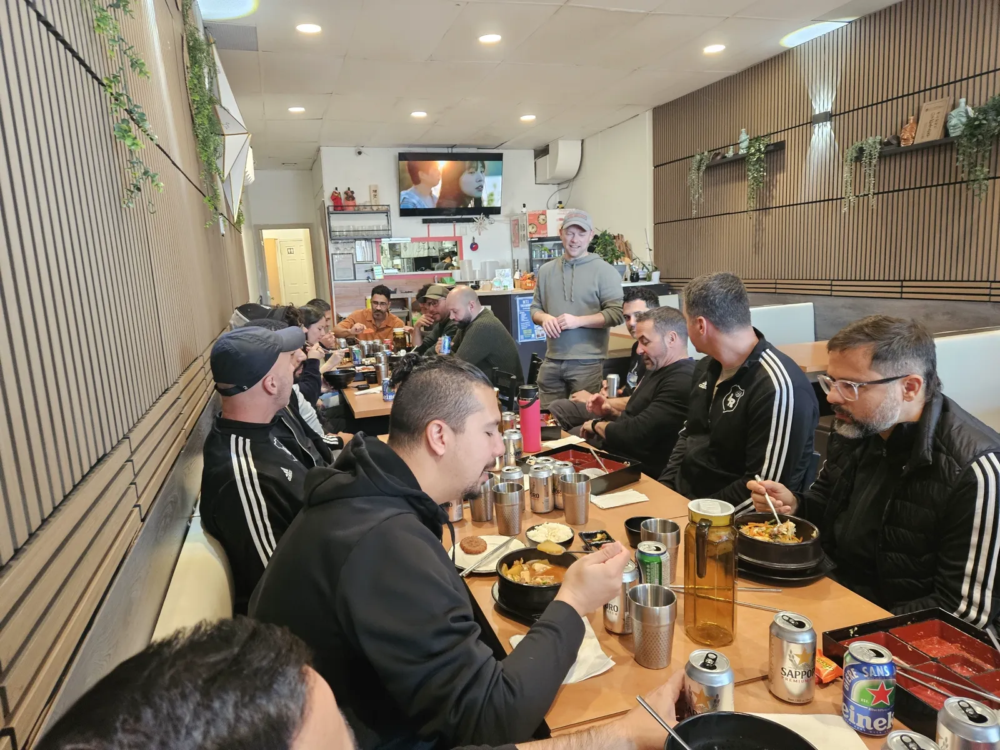

팀 이름은 농담처럼 지어질 때가 많습니다. 저희 팀 이름은 예언이 되었습니다. 다만 모두가 예상한 쪽은 아니었습니다.

## 두 가지 뜻을 가진 이름

락바텀스는 저희 가게가 있는 바로 이 동네, Pierrefonds에서 만들어진 팀입니다. 불어로 Pierre는 돌(rock)이라서 Pierrefonds Rock Bottom이라는 이름이 자연스럽게 붙었습니다. 그런데 오늘 연설에서 한 팀원이 털어놓았듯이, 이 이름에는 오랫동안 다른 뜻도 있었습니다. 늘 순위표 맨 밑바닥(rock bottom)에 있었다는 뜻입니다.

올해는 다릅니다. 올해 락바텀스는 **West Island Old Timers** 리그 챔피언입니다.

## 우승까지의 길

일요일 세 번, 세 경기 모두 이겼습니다. 장소는 모두 Lake Turf였습니다.

- **플레이오프**, 9월 20일: 락바텀스 3 - 1 Cafeteros FC
- **준결승**, 9월 27일: 락바텀스 3 - 2 Earth Love United
- **결승**, 10월 4일: 락바텀스 1 - 0 SVG Utd

결승은 단 한 골 차이로 이겼습니다.

## 멋진 한 해

<video width="100%" controls playsinline style="border-radius: 10px; margin: 20px 0;">
  <source src="/img/blog/20261101_rockbottom_speech.mp4" type="video/mp4">
</video>

연설은 불어로 했습니다. Chris 같은 선수들 덕분에 팀이 아주 강해졌고, 힘든 경기도 있었지만, 그의 말대로 *"une année merveilleuse"*, 정말 멋진 한 해였습니다. 모두 축하합니다!

## 트로피요? 저희는 돌멩이를 드립니다

몇몇 선수에게 상이 돌아갔습니다. 하지만 락바텀스는 평범한 트로피를 주지 않습니다. 수상자마다 상자를 하나씩 받았는데, 열어 보니 돌멩이가 들어 있었습니다. 이름이 돌인 팀이 달리 무엇을 주겠습니까?

## 챔피언을 위한 도시락

축하 자리를 도시락에서 함께할 수 있어서 자랑스러웠습니다. 긴 테이블, 가득 찬 도시락, 끊이지 않는 웃음, 그리고 가장 어린 팬은 엄지를 척 들어 주었습니다.

락바텀스, 축하합니다. 순위표 맨 아래에서 리그 맨 위까지 올라왔습니다. 저희 테이블은 언제나 여러분을 위해 비어 있습니다.

⚽ 가자 락바텀스! 🏆
